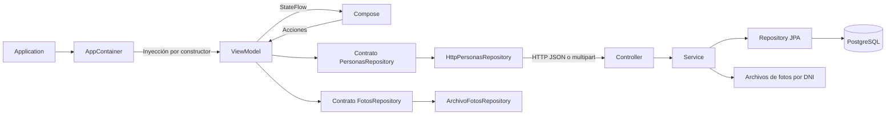

# Personas

Personas es una aplicación Android para registrar personas con fotografía, consultar sus datos por DNI, actualizar la ficha y realizar eliminaciones lógicas. La interfaz utiliza Kotlin y Jetpack Compose; una API Spring Boot administra las operaciones y la persistencia en PostgreSQL.

## Componentes

| Componente | Tecnología |
| --- | --- |
| Aplicación Android | Kotlin 2.2.10, Jetpack Compose BOM 2026.02.01 y Material 3 |
| Arquitectura Android | MVVM, repositorios, StateFlow, SavedStateHandle e inyección manual por constructor |
| Configuración Android | Android mínimo 24, objetivo 37, Android Gradle Plugin 9.4.1 y Gradle 9.6 |
| API | Java 25, Spring Boot 4.1.1, Spring MVC, JPA y Bean Validation |
| Base de datos | PostgreSQL 18 |
| Fotografías | Captura mediante la cámara del sistema, selector de fotos de Android y archivos JPEG en el servidor |

## Ejecución local

El entorno de desarrollo requiere Windows, Android Studio con SDK 37, JDK 25, PostgreSQL 18, Maven 3.9.16 y un emulador o teléfono USB autorizado. La sincronización inicial descarga las dependencias de Android y de la API.

1. La carpeta raíz, que contiene `settings.gradle.kts`, se abre en Android Studio.
2. La sincronización configura el módulo `app` y la ubicación local del SDK.
3. `backend/.env` contiene la conexión al PostgreSQL instalado. `.env.example` proporciona el formato; la contraseña corresponde al usuario de la instalación local.
4. Se seleccionan la configuración **app** y el dispositivo de destino.
5. **Run** ejecuta el arranque de PostgreSQL y de la API antes de compilar e instalar Android.
6. En Android 17, la aplicación solicita permiso de acceso a la red local para comunicarse con la API.

El arranque está integrado mediante `.run/app.run.xml` y la dependencia de `preDebugBuild` respecto a `:app:startLocalServices`. El uso habitual no requiere ejecutar comandos adicionales.

### Herramientas y rutas

| Herramienta | Ruta predeterminada | Variable alternativa |
| --- | --- | --- |
| PostgreSQL 18 | `C:\Program Files\PostgreSQL\18\bin` | `PERSONAS_PG_BIN`: carpeta que contiene `psql.exe` y `pg_isready.exe` |
| JDK 25 para la API | `C:\Program Files\Eclipse Adoptium\jdk-25.0.4.101-hotspot` | `PERSONAS_JAVA_HOME`: raíz del JDK |
| Maven 3.9.16 | `%USERPROFILE%\.maven\maven-3.9.16` | `PERSONAS_MAVEN_HOME`: raíz de Maven |
| Android SDK | Ubicación de Android Studio en `local.properties` | `ANDROID_HOME` o `ANDROID_SDK_ROOT` |

Las variables alternativas permiten utilizar otras ubicaciones de instalación. Android Studio recibe esas variables al iniciarse. `local.properties` pertenece a cada equipo y queda excluido de Git.

### Servicios y datos locales

La conexión local utiliza el PostgreSQL instalado en **localhost:5432**, con usuario **postgres** y base **personas_app**. `localhost` identifica al equipo que ejecuta el servidor; `postgres` es el usuario de la base de datos. La contraseña se configura únicamente en `backend/.env`. El arranque crea la base si todavía no existe; la API inicializa el esquema, las tablas y el catálogo. El usuario configurado requiere permiso para crear la base durante ese primer arranque.

PostgreSQL funciona como servicio de Windows con inicio automático. Si el servidor no responde, Run solicita el inicio del servicio indicado en `POSTGRES_SERVICE`, cuyo valor predeterminado es `postgresql-x64-18`. La cuenta de Windows necesita permiso para iniciar ese servicio. El proyecto utiliza esa instalación y conserva sus demás bases de datos.

La API escucha en el puerto **8081**. El arranque comprueba `/api/health`, que realiza una consulta a PostgreSQL. Los cambios de fuentes de la API provocan su compilación y reinicio. Los cambios de `.env` reinician la API con la nueva conexión; una instancia propia actualizada se reutiliza. La sustitución de un proceso requiere verificar su instancia, PID, fecha de inicio y ejecutable.

La conexión Android se resuelve automáticamente: el emulador utiliza `10.0.2.2:8081` y el teléfono USB utiliza `127.0.0.1:8081` mediante `adb reverse`. El emulador accede directamente al host. La interfaz no contiene una configuración de IP.

PostgreSQL y la API permanecen activos después de cerrar Android. El log de la API se encuentra en `.local/api.log`; PostgreSQL utiliza los logs y el directorio de datos de su instalación de Windows. `backend/.env` contiene la configuración local y `.local` conserva el estado de arranque de la API. El wrapper de Windows utiliza `.gradle/tmp` como directorio temporal de su ejecución y configura los sockets locales mediante `jdk.net.unixdomain.tmpdir`.

## Consulta de PostgreSQL con pgAdmin

La conexión se registra en **Servers → Register → Server**. La pestaña **General** admite el nombre `Personas local`; la pestaña **Connection** utiliza estos valores:

| Campo | Valor |
| --- | --- |
| Host name/address | `localhost` |
| Port | `5432` |
| Maintenance database | `personas_app` |
| Username | `postgres` |
| Password | Valor de `DB_PASSWORD` del archivo local `backend/.env` |

La conexión requiere que los servicios del proyecto estén activos. El archivo `.env` contiene las credenciales del PostgreSQL local y queda excluido del repositorio.

La tabla se encuentra en **Personas local → Databases → personas_app → Schemas → personas → Tables → persona**. La opción **View/Edit Data → All Rows** muestra las filas activas e inactivas. La tabla `profesion` contiene el catálogo relacionado.

El **Query Tool** permite consultar la ficha y su profesión:

```sql
SELECT p.dni, p.nombres, p.apellidos, pr.nombre AS profesion,
       p.direccion, p.celular, p.correo, p.foto_ruta, p.estado
FROM personas.persona AS p
JOIN personas.profesion AS pr ON pr.id = p.profesion_id
ORDER BY p.apellidos, p.nombres;
```

La consulta de registros eliminados utiliza el campo de estado:

```sql
SELECT dni, nombres, apellidos, estado
FROM personas.persona
WHERE estado = 'INACTIVO';
```

La [documentación de conexión de pgAdmin](https://www.pgadmin.org/docs/pgadmin4/latest/server_dialog.html) describe los campos del registro de servidor.

## Flujo de la aplicación

La pantalla inicial contiene **Buscar por DNI** y **Nuevo**. Una búsqueda válida devuelve una ficha resumida con iconos para consultar, editar y eliminar. La selección del resumen abre la ficha completa.

**Nuevo** presenta un borrador vacío. El formulario se distribuye en tres pestañas:

| Pestaña | Contenido |
| --- | --- |
| Datos | DNI, nombres, apellidos y profesión. El catálogo incluye **Añadir profesión…**, que registra y selecciona una profesión nueva. |
| Contacto | Dirección, celular y correo electrónico. La ficha superior refleja los cambios y separa el contacto con barras verticales. |
| Foto | **Tomar foto** y **Adjuntar foto**. Cuando existe una imagen, las acciones cambian a **Volver a tomar** y **Reemplazar foto**. |

**Siguiente** valida la sección actual. **Guardar** valida el formulario completo y presenta una confirmación. Durante la edición, el DNI permanece bloqueado y la fotografía anterior se conserva hasta seleccionar un reemplazo. El cierre de un formulario modificado y la eliminación requieren confirmación.

La modal adapta su distribución a la pantalla. El cuerpo admite desplazamiento cuando aparece el teclado o se amplía el texto; las acciones permanecen al pie. El borrador y la captura pendiente se restauran mediante `SavedStateHandle` al recrearse la actividad.

## Estructura del repositorio

```text
Personas/
├── app/
│   ├── build.gradle.kts
│   └── src/
│       ├── main/
│       │   ├── AndroidManifest.xml
│       │   ├── java/com/example/personas/
│       │   │   ├── MainActivity.kt
│       │   │   ├── PersonasApplication.kt
│       │   │   ├── di/
│       │   │   ├── domain/
│       │   │   ├── data/
│       │   │   ├── viewmodel/
│       │   │   └── ui/
│       │   │       └── theme/
│       │   └── res/
│       ├── debug/AndroidManifest.xml
│       ├── test/java/com/example/personas/
│       └── androidTest/java/com/example/personas/
├── backend/
│   ├── pom.xml
│   ├── .env.example
│   ├── storage/fotos/              (directorio generado)
│   └── src/
│       ├── main/java/com/example/personas/
│       │   ├── App.java
│       │   ├── controller/
│       │   ├── dto/
│       │   ├── service/
│       │   ├── repository/
│       │   └── model/
│       ├── main/resources/db/
│       └── test/java/com/example/personas/
├── scripts/
├── gradle/
├── .run/app.run.xml
├── build.gradle.kts
├── settings.gradle.kts
├── gradle.properties
├── gradlew / gradlew.bat
└── README.md
```

La vista **Project** del panel izquierdo de Android Studio muestra la carpeta raíz completa: `app`, `backend`, `scripts` y los archivos de configuración. La vista **Android** agrupa únicamente el módulo Android y oculta carpetas externas a ese módulo. El código del servidor está en `backend/src/main/java/com/example/personas/`.

### Android

Las rutas Kotlin siguientes son relativas a `app/src/main/java/com/example/personas/`.

| Archivo o carpeta | Responsabilidad |
| --- | --- |
| `MainActivity.kt` | Punto de entrada visual. Configura las barras del sistema, obtiene el ViewModel de su fábrica y muestra la interfaz. |
| `PersonasApplication.kt` | Mantiene el contenedor de dependencias durante la vida del proceso. |
| `di/AppContainer.kt` | Construye las implementaciones de repositorios y la fábrica del ViewModel. La fábrica recibe el `SavedStateHandle` del ciclo de vida. |
| `domain/Persona.kt` | Modelo de la ficha de una persona. |
| `domain/Profesion.kt` | Modelo del catálogo de profesiones. |
| `domain/Borrador.kt` | Datos editables del formulario, fotografía pendiente e información de la ficha en vivo. |
| `domain/CapturaFoto.kt` | Ruta del archivo temporal y URI que utiliza la cámara. |
| `domain/Validacion.kt` | Reglas de DNI, celular, correo y formulario; correspondencia entre campos y pestañas. |
| `domain/PersonasRepository.kt` | Contrato de búsqueda, alta, actualización, eliminación y catálogo. |
| `domain/FotosRepository.kt` | Contrato de preparación de captura, importación y limpieza de archivos temporales. |
| `domain/ServidorUrl.kt` | Política de validación del origen HTTP/HTTPS. |
| `data/HttpPersonasRepository.kt` | Implementación HTTP del contrato de personas: JSON, multipart y traducción de errores de la API. |
| `data/ApiException.kt` | Error de respuesta con código HTTP, mensaje y campos inválidos. |
| `data/PersonaJson.kt` | Conversión JSON de personas y borradores, incluida la serialización del estado guardado. |
| `data/ApiConfig.kt` | Resolución automática del origen de la API o lectura del origen definido al compilar. |
| `data/ArchivoFotosRepository.kt` | Implementación del contrato de fotos. Encapsula `Context`, `FileProvider`, URI e importación fuera del hilo principal. |
| `data/FotoImporter.kt` | Validación de tamaño, orientación EXIF, conversión JPEG y limpieza de borradores privados. |
| `data/FotoLoader.kt` | Lectura de imágenes locales o remotas, reducción de resolución y caché de bitmaps. |
| `viewmodel/PersonasViewModel.kt` | Coordinación del formulario y operaciones mediante repositorios inyectados. Expone `StateFlow` y conserva datos en `SavedStateHandle`; no recibe `Application` ni `Context`. |
| `viewmodel/Pantalla.kt` | Estado de pantalla: ficha, borrador, pestaña, catálogo, errores, carga y confirmaciones. |
| `viewmodel/Aviso.kt` | Título y mensaje de los avisos de validación. |
| `ui/PersonasApp.kt` | Pantalla inicial, resultados, permiso de red y lanzadores de cámara y galería. |
| `ui/FichaModal.kt` | Contenedor de consulta/edición, título, cierre, desplazamiento y acciones. |
| `ui/EditorPersona.kt` | Campos, catálogo, pestañas y acciones de fotografía. |
| `ui/FichaPersona.kt` | Resumen, ficha en vivo y detalle de consulta. |
| `ui/FotoPersona.kt` | Representación de la fotografía, iniciales o marcador vacío. |
| `ui/DialogosPersona.kt` | Confirmaciones, validaciones y registro de profesiones. |
| `ui/Campos.kt`, `Botones.kt`, `AppIcon.kt` | Controles e iconos reutilizables con etiquetas accesibles. |
| `ui/theme/Theme.kt`, `Type.kt` | Tema claro, color azul de acciones y tipografía. |

El manifiesto principal declara la `Application`, actividad, permisos de red y `FileProvider`. El manifiesto de `debug` habilita HTTP para desarrollo. `res/xml/file_paths.xml` delimita el directorio de borradores que puede compartir la cámara; las demás carpetas de recursos contienen nombre, tema, iconos y reglas de respaldo.

`app/src/test` contiene validaciones y pruebas aisladas del ViewModel con repositorios sustitutos. `app/src/androidTest` contiene pruebas de interacción, pestañas, teclado, fichas e iconos. `app/build.gradle.kts` define dependencias, SDK, variantes, origen compilado de la API y arranque de servicios.

### API

Las rutas Java siguientes son relativas a `backend/src/main/java/com/example/personas/`.

| Archivo o carpeta | Responsabilidad |
| --- | --- |
| `App.java` | Arranque de Spring Boot y carga de `.env`, respetando variables de entorno existentes. |
| `controller/PersonaController.java` | Recepción HTTP, validación de DTO, delegación al servicio y respuestas HTTP; incluye la comprobación de disponibilidad. |
| `controller/ApiExceptionHandler.java` | Respuestas JSON consistentes para validación, duplicados, formato y tamaño de archivo. |
| `dto/PersonaRequest.java`, `ProfesionRequest.java` | Contratos de entrada y validación del servidor. |
| `dto/PersonaResponse.java`, `ProfesionResponse.java` | Contratos de salida con nombre de profesión y URL de fotografía. |
| `service/PersonaService.java` | Reglas de negocio, transacciones, reserva del DNI, catálogo y acceso a personas activas. |
| `service/FotoStorage.java` | Validación de imágenes, carpetas por DNI, nombres UUID y limpieza de archivos según el resultado de la transacción. |
| `service/ApiError.java` | Error de negocio con código HTTP. |
| `repository/PersonaRepository.java` | Consultas JPA, filtro por estado y bloqueo de filas durante modificaciones. |
| `repository/ProfesionRepository.java` | Catálogo ordenado y búsqueda de nombres normalizados. |
| `model/Persona.java`, `Profesion.java` | Entidades JPA y relación entre persona y profesión. |
| `model/EstadoPersona.java` | Estados `ACTIVO` e `INACTIVO`. |

En `backend/src/main/resources`, `application.properties` define conexión, puerto, inicialización SQL y límites multipart. La carpeta `db` contiene:

| Archivo | Función |
| --- | --- |
| `schema.sql` | Tablas, claves, índice y restricciones. |
| `data.sql` | Catálogo inicial sin duplicación en arranques posteriores. |
| `migrate-estado.sql` | Conversión del indicador antiguo al campo `estado`, conservando activos e inactivos. |
| `migrate-foto-ruta.sql` | Restricción de rutas de fotografía y correspondencia entre carpeta y DNI. |

`backend/src/test` contiene validaciones y comprobaciones de almacenamiento transaccional. `pom.xml` define Java, Spring Boot, JPA, validación, PostgreSQL, dotenv y empaquetado. `.env.example` describe el formato de configuración. Si falta `.env`, Run copia la plantilla y señala los valores pendientes de configurar antes de conectar.

### Configuración y herramientas

| Archivo o carpeta | Función |
| --- | --- |
| `settings.gradle.kts`, `build.gradle.kts` | Módulos, repositorios y plugins del proyecto Android. |
| `gradle/libs.versions.toml` | Versiones y alias de dependencias Android. |
| `gradle/wrapper`, `gradlew`, `gradlew.bat` | Distribución de Gradle del proyecto. |
| `gradle/gradle-daemon-jvm.properties`, `gradle.properties` | JVM del daemon, memoria, codificación y caché. |
| `.run/app.run.xml` | Configuración Run con preparación previa de servicios. |
| `scripts/start-local-services.ps1` | Lectura de `.env`, inicio del servicio PostgreSQL cuando se requiere, creación de la base, compilación y reinicio de API, comprobación de disponibilidad y túnel USB. |
| `scripts/maven.ps1` | Ejecución de Maven con el JDK configurado. |
| `scripts/postgres_config.py` | Lectura compartida de la conexión PostgreSQL para las herramientas de integración. |
| `scripts/test-api.py` | Comprobaciones HTTP/SQL sobre una base desechable. |
| `scripts/emulator-services.py` | API y base temporales para interacción desde el emulador. |
| `scripts/emulator-ui.py` | Accesibilidad, escritura y capturas mediante ADB; utiliza por defecto `C:\Android\Sdk` y `emulator-5556`. |
| `.gitignore`, `.gitattributes` | Exclusiones de archivos locales y normalización de formatos. |

`.local`, `.gradle`, `.kotlin`, `build`, `app/build`, `backend/target` y `backend/storage` son directorios generados. Las credenciales, fotos de usuarios, informes locales y configuración del IDE permanecen fuera del repositorio. `.env` almacena valores de configuración; `.gitignore` define qué rutas quedan excluidas de Git. La plantilla `.env.example` se publica sin contraseñas reales.

## Comunicación entre componentes



`AppContainer` construye las implementaciones y las proporciona al ViewModel mediante una fábrica. El ViewModel utiliza los contratos de repositorio y administra el estado de pantalla. Las dependencias de Android necesarias para archivos y URI permanecen en la implementación de fotografías.

Durante un alta, Compose actualiza el borrador; el ViewModel valida y solicita confirmación. El repositorio HTTP envía los datos JSON y la foto multipart. El Controller valida la entrada y delega al Service, que comprueba el DNI y la profesión y persiste la entidad dentro de una transacción. La respuesta actualiza el `StateFlow` y la ficha visible.

## Modelo relacional y eliminación lógica

El esquema `personas` contiene las tablas `profesion` y `persona`. Una profesión puede pertenecer a varias personas; cada persona requiere una profesión existente.

| Tabla / columna | Tipo y restricción |
| --- | --- |
| `profesion.id` | `BIGINT`, identidad y clave primaria. |
| `profesion.nombre` | `VARCHAR(80)`, obligatorio. |
| `profesion.nombre_clave` | `VARCHAR(80) UNIQUE`, normalizado sin diferencias de tildes, mayúsculas o espacios repetidos. |
| `persona.dni` | `VARCHAR(8) PRIMARY KEY`, ocho dígitos con conservación de ceros iniciales. |
| `persona.nombres`, `persona.apellidos` | `VARCHAR(100)`, obligatorios. |
| `persona.direccion` | `VARCHAR(200)`, obligatoria. |
| `persona.profesion_id` | `BIGINT NOT NULL`, clave foránea a `profesion.id`, índice y `ON DELETE RESTRICT`. |
| `persona.celular` | `VARCHAR(9)`, nueve dígitos con inicio en 9. |
| `persona.correo` | `VARCHAR(180)`, obligatorio y con formato de correo. |
| `persona.foto_ruta` | `VARCHAR(80)`, ruta relativa de la fotografía. La carpeta, cuando está presente, debe coincidir con el DNI. |
| `persona.estado` | `VARCHAR(8) NOT NULL DEFAULT 'ACTIVO'`, limitado a `ACTIVO` o `INACTIVO`. |

La eliminación cambia el estado a `INACTIVO` y conserva la fila y su fotografía. Las búsquedas, ediciones y descargas de foto excluyen los registros inactivos. El DNI permanece reservado; la clave primaria protege también frente a altas simultáneas.

Las validaciones de Android proporcionan avisos inmediatos. La API valida cualquier solicitud y PostgreSQL aplica restricciones de integridad. Hibernate utiliza `ddl-auto=validate`; los archivos SQL controlan el esquema.

## Almacenamiento de fotografías

Las imágenes se organizan según su función:

| Ubicación | Contenido |
| --- | --- |
| `app/src/main/res/drawable/` | Imágenes, formas e iconos incluidos al compilar el APK. |
| `app/src/main/res/mipmap-*/` | Iconos de lanzamiento con distintas densidades. |
| Almacenamiento privado de Android, `filesDir/drafts/` | Archivos de captura e importación mientras se prepara el formulario. |
| Selector de fotos de Android | Acceso a las imágenes seleccionadas de la galería del dispositivo. |
| `backend/storage/fotos/` | Fotografías persistentes de las personas registradas. |

Los [recursos drawable](https://developer.android.com/guide/topics/resources/drawable-resource) forman parte de la aplicación compilada. Los archivos capturados durante el uso requieren [almacenamiento de ejecución](https://developer.android.com/training/data-storage/app-specific); en este proyecto, el servidor conserva la fotografía definitiva.

En la instalación local, la ruta es `C:\Android\Personas\backend\storage\fotos`. El directorio raíz se crea al iniciar la API y cada subcarpeta por DNI aparece al guardar una persona con fotografía. La vista **Project** permite recorrer esa ubicación.

Las fotografías se guardan por persona, dentro de una carpeta identificada por su DNI:

```text
backend/storage/fotos/
└── 01234567/
    └── <uuid>.jpg
```

La columna `foto_ruta` almacena la ruta relativa `01234567/<uuid>.jpg`. El directorio raíz procede de `PHOTO_DIRECTORY`; la URL pública de consulta se genera mediante `/api/personas/{dni}/foto`. PostgreSQL almacena la ubicación del archivo.

Un reemplazo crea un archivo nuevo en la misma carpeta. El commit elimina la foto anterior; un rollback elimina la nueva y conserva la anterior. La eliminación lógica mantiene la carpeta y el archivo. Las rutas antiguas de un solo nombre UUID siguen siendo legibles; una sustitución utiliza el formato por DNI.

La captura utiliza `ActivityResultContracts.TakePicture` con `FileProvider` y la cámara instalada en el dispositivo. `PickVisualMedia` abre el selector de Android. La aplicación delega la captura y no declara permiso `CAMERA` ni acceso general al almacenamiento. La importación limita el tamaño, corrige la orientación EXIF y convierte a JPEG antes del envío. La API valida el contenido real, con límite de 10 MB y 24 millones de píxeles.

## API HTTP

| Método | Ruta | Operación |
| --- | --- | --- |
| GET | `/api/health` | Disponibilidad de API/PostgreSQL, instancia y versión. |
| GET / POST | `/api/profesiones` | Catálogo o nueva profesión con JSON `nombre`. |
| POST | `/api/personas` | Alta multipart con `datos` JSON y `foto`. |
| GET | `/api/personas/{dni}` | Ficha de persona activa. |
| PUT | `/api/personas/{dni}` | Actualización multipart; la foto es opcional y el DNI permanece fijo. |
| DELETE | `/api/personas/{dni}` | Eliminación lógica con respuesta 204. |
| GET | `/api/personas/{dni}/existe` | Reserva de DNI, incluidos registros inactivos. |
| GET | `/api/personas/{dni}/foto` | JPEG de persona activa. |

La consulta de personas se realiza por DNI. Los errores incluyen `mensaje` y, cuando corresponde, `campos`. Los códigos principales son 400 para datos inválidos, 404 para recursos no disponibles, 409 para duplicados y 413 para exceso de tamaño.

## Configuración de despliegue

El APK debug utiliza la conexión local automática. Una compilación release requiere una API desplegada con HTTPS y la propiedad Gradle `PERSONAS_API_URL` definida durante la compilación. El origen se configura en el proceso de construcción; la pantalla de la aplicación no solicita direcciones al usuario.

El arranque automático administra los servicios de desarrollo en el PC. Un teléfono ejecuta el cliente Android y se comunica con la API del entorno configurado.
