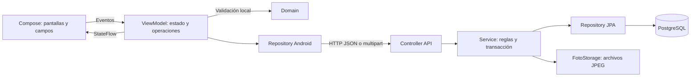

# Personas

Aplicación del Trabajo N.º 3 de Tecnología y Desarrollo Móvil. Permite registrar una persona con fotografía, buscarla por DNI, consultar su ficha, actualizar sus datos o foto y eliminarla de forma lógica.

La interfaz está hecha con **Kotlin y Jetpack Compose**. Se conservan Kotlin 2.2.10, Compose BOM 2026.02.01 y Android Gradle Plugin 9.4.1; Android mínimo 24 y objetivo 37. Android se comunica por HTTP/JSON con una **API Spring Boot en Java**, y la API guarda los datos en **PostgreSQL**. El teléfono no se conecta directamente a PostgreSQL.

## Abrir y ejecutar

El arranque automático está preparado para **Windows**. Se necesitan Android Studio con SDK 37, un emulador o teléfono USB autorizado, JDK 25, PostgreSQL 18 y Maven 3.9.16 instalados. La primera sincronización necesita Internet para descargar dependencias.

1. Clonar o descargar el repositorio y abrir su carpeta raíz en Android Studio, donde está `settings.gradle.kts`.
2. Esperar la sincronización y comprobar que Android Studio reconoce el SDK. `local.properties` se genera en cada equipo; no se comparte por Git.
3. Seleccionar la configuración **app** y un emulador o teléfono conectado por USB.
4. Pulsar **Run**. El proyecto prepara PostgreSQL y la API, comprueba su disponibilidad, compila e instala Android. No hay que ejecutar comandos adicionales en cada arranque.
5. En Android 17, permitir el acceso a la red local cuando se solicite.

La configuración `.run/app.run.xml` ejecuta `:app:startLocalServices` antes de la instalación. Además, `preDebugBuild` depende de esa tarea, por lo que también se ejecuta al construir la versión debug desde Gradle.

### Preparación de herramientas en otro equipo

Estas son las rutas predeterminadas del equipo de desarrollo. Si las herramientas están en otra ubicación, definir las variables indicadas antes de abrir Android Studio; después de cambiarlas, reiniciar el IDE para que las reciba.

| Herramienta | Ruta predeterminada | Variable alternativa |
| --- | --- | --- |
| PostgreSQL 18 | `C:\Program Files\PostgreSQL\18\bin` | `PERSONAS_PG_BIN`, carpeta que contiene `pg_ctl.exe`, `initdb.exe` y `psql.exe` |
| JDK 25 para la API | `C:\Program Files\Eclipse Adoptium\jdk-25.0.4.101-hotspot` | `PERSONAS_JAVA_HOME`, raíz del JDK |
| Maven 3.9.16 | `%USERPROFILE%\.maven\maven-3.9.16` | `PERSONAS_MAVEN_HOME`, raíz de esta versión de Maven |
| Android SDK | Configuración de Android Studio / `local.properties` | `ANDROID_HOME` o `ANDROID_SDK_ROOT` también sirven para el script |

No hace falta crear a mano la base, el usuario ni las tablas del proyecto. El script utiliza los ejecutables de PostgreSQL para crear un **cluster privado**, separado del servicio PostgreSQL de otras aplicaciones.

### Qué inicia Run

- PostgreSQL privado en `.local/postgres`, puerto **55440**, usuario `personas`, base `personas_app`.
- Credenciales aleatorias en `backend/.env`, generado la primera vez. El APK no incluye la contraseña.
- API en el puerto **8081**, con `/api/health` comprobando una consulta real a PostgreSQL.
- Compilación de la API cuando cambian sus fuentes. Se reutiliza una API propia que ya está actualizada; antes de sustituir un proceso se comprueban su instancia, PID, fecha de inicio y ejecutable.
- Conexión USB mediante `adb reverse`. En el emulador la app usa automáticamente `10.0.2.2`; en el teléfono USB usa `127.0.0.1`. **La interfaz no pide introducir una IP**.

La base y la API siguen encendidas después de cerrar la app Android. Run puede reutilizarlas. No borrar `.local` ni `backend/.env` si se quieren conservar los datos y la contraseña asociada. Los logs de los servicios están en `.local/api.log` y `.local/postgres.log`.

`jdk.net.unixdomain.tmpdir` está configurado en el wrapper de Windows, la JVM de Gradle y sus pruebas para evitar el error de conexión local de Java 25 detectado en este equipo, sin cambiar TEMP ni TMP globalmente.

## Cómo se usa

La pantalla inicial contiene **Buscar por DNI** y **Nuevo**. Al buscar un DNI existente se muestra una ficha resumida con iconos para ver, editar y eliminar. Al tocar la ficha se abre la consulta completa.

**Nuevo** abre una modal vacía, independiente del registro consultado. El formulario tiene tres pestañas:

| Pestaña | Contenido |
| --- | --- |
| Datos | DNI, nombres, apellidos y profesión. El catálogo permite **Añadir profesión…** y selecciona la profesión recién creada. |
| Contacto | Dirección, celular y correo. La ficha superior se actualiza mientras se escribe y separa los datos con barras verticales. |
| Foto | **Tomar foto** con la cámara del sistema o **Adjuntar foto** desde el selector de Android. Si ya hay una foto, aparecen **Volver a tomar** y **Reemplazar foto**. |

**Siguiente** valida la sección actual. **Guardar** valida todo y pide confirmación antes de enviar los datos. En edición, el DNI queda bloqueado y la foto anterior se conserva si no se elige otra. Cerrar un formulario modificado pide confirmar que se descartan los cambios. La eliminación también requiere confirmación.

La modal ajusta su distribución a pantallas pequeñas, mantiene las acciones al pie y permite desplazar los campos cuando aparece el teclado o se amplía el texto.

## Estructura del repositorio

```text
Personas/
├── app/
│   ├── build.gradle.kts
│   └── src/
│       ├── main/
│       │   ├── AndroidManifest.xml
│       │   ├── java/com/example/personas/
│       │   │   ├── MainActivity.kt
│       │   │   ├── domain/
│       │   │   ├── data/
│       │   │   ├── viewmodel/
│       │   │   └── ui/theme/
│       │   └── res/
│       ├── debug/AndroidManifest.xml
│       ├── test/java/com/example/personas/
│       └── androidTest/java/com/example/personas/
├── backend/
│   ├── pom.xml
│   └── src/
│       ├── main/java/com/example/personas/
│       │   ├── App.java
│       │   ├── controller/
│       │   ├── dto/
│       │   ├── service/
│       │   ├── repository/
│       │   └── model/
│       ├── main/resources/db/
│       └── test/java/com/example/personas/
├── scripts/
├── gradle/
├── .run/app.run.xml
├── docs/capturas/
├── build.gradle.kts
├── settings.gradle.kts
├── gradle.properties
├── gradlew / gradlew.bat
├── QA_EMULADOR.md
└── README.md
```

### Android: responsabilidad de cada carpeta y archivo

Las rutas de Kotlin de esta tabla son relativas a `app/src/main/java/com/example/personas/`.

| Ubicación | Responsabilidad |
| --- | --- |
| `MainActivity.kt` | Punto de entrada Android. Prepara las barras del sistema, aplica el tema y muestra `PersonasApp`. |
| `domain/Persona.kt` | Modelos `Persona`, `Profesion` y `Borrador`; reglas de validación y correspondencia entre campos y pestañas. No contiene HTTP ni componentes visuales. |
| `domain/ServidorUrl.kt` | Política de validación del origen HTTP/HTTPS usado internamente. No crea una pantalla de configuración. |
| `data/ApiConfig.kt` | Resuelve el servidor automáticamente para emulador o USB, o toma el origen definido al compilar. |
| `data/PersonasRepository.kt` | Operaciones HTTP de personas y profesiones, JSON, envío multipart y conversión de respuestas o errores. Trabaja fuera del hilo principal. |
| `data/FotoImporter.kt` | Crea capturas temporales, importa la imagen seleccionada, limita su tamaño, corrige la orientación EXIF, genera JPEG y limpia el borrador. |
| `data/FotoLoader.kt` | Lee fotos locales o remotas, reduce su tamaño para visualización y mantiene la caché de bitmaps. La UI no abre conexiones HTTP. |
| `viewmodel/PersonasViewModel.kt` | Estado `Pantalla`, operaciones de búsqueda/alta/edición/eliminación, navegación del formulario y diálogos. Expone `StateFlow`; `SavedStateHandle` conserva el borrador y la captura pendiente al recrearse la actividad. |
| `ui/PersonasApp.kt` | Pantalla inicial, resultados, permiso de red local y lanzadores de cámara y selector de fotos. |
| `ui/FichaModal.kt` | Contenedor de la ficha, título, cierre, desplazamiento y botones del pie. |
| `ui/EditorPersona.kt` | Campos de Datos/Contacto/Foto, pestañas, catálogo y botones de fotografía. |
| `ui/FichaPersona.kt` | Resultado resumido, ficha en vivo y contenido de consulta. |
| `ui/FotoPersona.kt` | Presentación de la foto, iniciales o marcador vacío. Solicita la imagen a `FotoLoader`. |
| `ui/DialogosPersona.kt` | Confirmaciones, avisos de validación y alta de profesiones. |
| `ui/Campos.kt`, `Botones.kt`, `AppIcon.kt` | Controles reutilizables, entradas, botones e iconos con etiquetas accesibles. |
| `ui/theme/Theme.kt`, `Type.kt` | Tema claro blanco/gris, azul de botones y pestañas, y tipografía. |

Otros archivos de Android:

| Ubicación | Función |
| --- | --- |
| `app/src/main/AndroidManifest.xml` | Actividad de inicio, permisos de Internet/red local y `FileProvider`. |
| `app/src/debug/AndroidManifest.xml` | Permite HTTP en desarrollo; el manifiesto principal mantiene HTTP bloqueado en release. |
| `app/src/main/res/xml/file_paths.xml` | Directorio de borradores que se comparte temporalmente con la cámara mediante URI. |
| `app/src/main/res/xml/*backup*`, `data_extraction_rules.xml` | Reglas de extracción y respaldo; la app desactiva el backup de sus datos. |
| `app/src/main/res/values`, `drawable`, `mipmap*` | Nombre, tema base e iconos de Android. |
| `app/src/test` | Pruebas JVM de DNI, celular, correo, formulario y configuración de URL. |
| `app/src/androidTest` | Pruebas en Android: pestañas, formulario, teclado, ficha en vivo, acciones accesibles y texto ampliado. |
| `app/build.gradle.kts` | SDK, dependencias, variantes, servidor compilado y dependencia del arranque automático. |

### API: responsabilidad de cada carpeta y archivo

Las rutas Java son relativas a `backend/src/main/java/com/example/personas/`.

| Ubicación | Responsabilidad |
| --- | --- |
| `App.java` | Inicia Spring Boot y carga `.env` si existe, respetando las variables ya definidas. |
| `controller/PersonaController.java` | Recibe HTTP, valida los DTO y delega las operaciones al servicio; devuelve códigos y cuerpos HTTP. Incluye la comprobación de salud. |
| `controller/ApiExceptionHandler.java` | Convierte errores de validación, duplicados, formato y tamaño de foto a respuestas JSON consistentes. |
| `dto/PersonaRequest.java`, `ProfesionRequest.java` | Contratos de entrada y validaciones del servidor. |
| `dto/PersonaResponse.java`, `ProfesionResponse.java` | Contratos de salida; exponen el nombre de profesión y la URL de foto que necesita Android. |
| `service/PersonaService.java` | Reglas de negocio, reserva del DNI, profesión existente, normalización de profesiones y transacciones. Solo consulta, edita o elimina personas activas. |
| `service/FotoStorage.java` | Valida la imagen real, guarda JPEG con nombre UUID, recupera archivos y limpia fotos según el resultado de la transacción. |
| `service/ApiError.java` | Error de negocio con código HTTP para el manejador central. |
| `repository/PersonaRepository.java` | Consultas JPA, filtro por estado y bloqueo de filas para modificar/eliminar sin carreras. |
| `repository/ProfesionRepository.java` | Catálogo ordenado y comprobación de nombres normalizados. |
| `model/Persona.java`, `Profesion.java` | Entidades JPA y relación entre tablas. La entidad Persona recibe valores de dominio; no depende de DTO HTTP. |
| `model/EstadoPersona.java` | Valores permitidos del estado: `ACTIVO` e `INACTIVO`. |
| `backend/src/main/resources/application.properties` | Puerto, conexión, inicialización SQL, validación del esquema, almacenamiento y límites multipart. |
| `backend/src/main/resources/db/schema.sql` | Tablas, claves, relación, índice y restricciones SQL. |
| `backend/src/main/resources/db/migrate-estado.sql` | Convierte el antiguo booleano `activo` al campo `estado`; conserva activos e inactivos y admite ejecuciones repetidas. |
| `backend/src/main/resources/db/data.sql` | Catálogo inicial de profesiones, sin duplicarlo en cada arranque. |
| `backend/src/test` | Pruebas de validación del servidor y almacenamiento/limpieza transaccional de fotos. |
| `backend/pom.xml` | Java 25, Spring Boot 4.1.1, JPA, validación, PostgreSQL, dotenv y empaquetado del JAR. |
| `backend/.env.example` | Ejemplo del formato de configuración sin una clave real. El uso habitual con Run genera `.env` automáticamente. |

### Configuración y herramientas del proyecto

| Archivo o carpeta | Qué hace |
| --- | --- |
| `settings.gradle.kts` | Declara el proyecto y sus módulos y repositorios de dependencias. |
| `build.gradle.kts` | Plugins compartidos del proyecto Android. |
| `gradle/libs.versions.toml` | Versiones y alias de las dependencias de Android. |
| `gradle/wrapper`, `gradlew`, `gradlew.bat` | Gradle 9.6 del proyecto; evita depender de una instalación global de Gradle. |
| `gradle/gradle-daemon-jvm.properties` | Requisito de Java 25 para el daemon de Gradle. |
| `gradle.properties` | Memoria, codificación, caché y ajustes de la JVM. No contiene contraseñas. |
| `.run/app.run.xml` | Configuración Run de Android Studio con el arranque de servicios como tarea previa. |
| `scripts/start-local-services.ps1` | Inicializa/reutiliza PostgreSQL, prepara credenciales, compila/reinicia la API propia y configura ADB. Usa un mutex para coordinar arranques simultáneos. |
| `scripts/maven.ps1` | Ejecuta Maven con el JDK configurado para la API. |
| `scripts/test-api.py` | Pruebas HTTP y SQL con una base desechable: migración, concurrencia, relaciones, restricciones y fotografías. |
| `scripts/emulator-services.py` | API y base temporales para pruebas desde el emulador; al detenerlas elimina esa base de verificación. |
| `scripts/emulator-ui.py` | Ayudante ADB para capturas, lectura de accesibilidad y escritura de campos en el emulador de pruebas. |
| `QA_EMULADOR.md`, `docs/capturas` | Resultado del recorrido real y capturas de evidencia con datos de prueba. |
| `.gitignore` | Excluye credenciales, bases locales, fotos de usuarios, cachés, archivos del IDE y compilaciones. |

Las carpetas `.local`, `.gradle`, `.kotlin`, `build`, `app/build`, `backend/target` y `backend/storage` se generan localmente. No son código fuente ni se suben a GitHub. El documento y audio originales del docente tampoco forman parte del repositorio.

## Cómo se comunican las partes



Ejemplo al guardar: Compose actualiza el `Borrador`; el ViewModel valida, pide confirmación y llama al Repository. El Repository envía `datos` como JSON y `foto` como archivo multipart. El Controller valida otra vez y llama al Service. El Service comprueba el DNI y la profesión, guarda la foto y persiste la entidad dentro de una transacción. El DTO de respuesta vuelve a Android, el ViewModel actualiza su estado y Compose muestra la ficha guardada.

Al reemplazar una fotografía, primero se guarda el nuevo archivo. Si la transacción confirma, se elimina el anterior; si falla, se elimina el nuevo. Así no se pierde la foto anterior por una actualización fallida. Las operaciones HTTP, lectura de imágenes e importación de fotos se ejecutan fuera del hilo principal de Android.

## Modelo de datos y eliminación lógica

El esquema es `personas`. Una profesión puede estar relacionada con muchas personas; cada persona debe tener exactamente una profesión existente.

| Tabla / columna | Tipo y regla |
| --- | --- |
| `profesion.id` | `BIGINT`, identidad y clave primaria. |
| `profesion.nombre` | `VARCHAR(80)`, obligatorio. |
| `profesion.nombre_clave` | `VARCHAR(80) UNIQUE`, nombre normalizado sin diferencias de tildes, mayúsculas o espacios repetidos. |
| `persona.dni` | `VARCHAR(8) PRIMARY KEY`, exactamente ocho dígitos. Conserva los ceros iniciales; no existe otro ID de persona. |
| `persona.nombres`, `apellidos` | `VARCHAR(100)`, obligatorios. |
| `persona.direccion` | `VARCHAR(200)`, obligatoria. |
| `persona.profesion_id` | `BIGINT NOT NULL`, clave foránea a `profesion.id`, con `ON DELETE RESTRICT`. Tiene índice. |
| `persona.celular` | `VARCHAR(9)`, exactamente nueve dígitos y el primero es 9. |
| `persona.correo` | `VARCHAR(180)`, obligatorio y con formato de correo validado. |
| `persona.foto_ruta` | `VARCHAR(80)`, nombre UUID terminado en `.jpg`. El archivo está en el servidor; no se guarda como texto Base64 en la tabla. |
| `persona.estado` | `VARCHAR(8) NOT NULL DEFAULT 'ACTIVO'`, restringido a `ACTIVO` o `INACTIVO`. |

**Eliminar cambia `estado` a `INACTIVO`; no hace `DELETE` de la fila.** La búsqueda, edición y descarga de foto excluyen las filas inactivas. Los datos y su fotografía se conservan, y el DNI continúa reservado. Intentar registrar de nuevo el mismo DNI, incluso después de eliminarlo, devuelve conflicto. La clave primaria también protege frente a dos altas simultáneas.

Las reglas se aplican en Android para avisar al usuario, en la API para validar cualquier cliente y en PostgreSQL para proteger la integridad. Hibernate usa `ddl-auto=validate`; la definición SQL controla el esquema.

La migración automática convierte los datos antiguos: `activo=true` pasa a `ACTIVO`, y `activo=false` a `INACTIVO`. Después retira el campo antiguo. Volver a ejecutar el arranque no reactiva personas.

## API HTTP

| Método | Ruta | Resultado |
| --- | --- | --- |
| GET | `/api/health` | Estado de API y PostgreSQL, instancia y versión. |
| GET | `/api/profesiones` | Catálogo de profesiones. |
| POST | `/api/profesiones` | Nueva profesión; JSON con `nombre`. |
| POST | `/api/personas` | Alta; multipart con `datos` JSON y `foto`. |
| GET | `/api/personas/{dni}` | Persona activa con su profesión y URL de fotografía. |
| PUT | `/api/personas/{dni}` | Edición; multipart con `datos` y foto opcional. El DNI no cambia. |
| DELETE | `/api/personas/{dni}` | Eliminación lógica; respuesta 204. |
| GET | `/api/personas/{dni}/existe` | Indica si el DNI está reservado, incluyendo personas inactivas. |
| GET | `/api/personas/{dni}/foto` | JPEG de una persona activa. |

No se publica un listado general de personas. Los errores devuelven `mensaje` y, cuando corresponde, `campos`; se usan 400 para datos inválidos, 404 para registros no disponibles, 409 para duplicados y 413 para fotografías demasiado grandes.

## Cámara, galería y configuración de despliegue

Se usa `ActivityResultContracts.TakePicture` con `FileProvider` para abrir la **aplicación de cámara del dispositivo**. No se integra una cámara propia ni se necesita CameraX para este flujo. `PickVisualMedia` abre el selector de fotos de Android. La app no necesita permiso general de almacenamiento ni declara `CAMERA`, porque delega la captura en la cámara instalada.

Las imágenes se importan a archivos privados de Android, se corrige la orientación y se convierten a JPEG. La API valida su contenido real y tamaño, y almacena el archivo en `backend/storage/fotos`. Solo su ubicación queda en PostgreSQL.

Para emulador y teléfono USB, Run resuelve la conexión de desarrollo. Un APK **release** necesita una API desplegada con HTTPS y `PERSONAS_API_URL` definido como propiedad de Gradle al compilar. El usuario final no configura direcciones en la pantalla. El arranque automático es una herramienta de desarrollo en el PC; una app instalada en un teléfono no inicia PostgreSQL dentro del dispositivo.

## Pruebas

El recorrido real está documentado en [QA_EMULADOR.md](QA_EMULADOR.md). Se verifican alta con foto, búsqueda, consulta, edición, reemplazo desde galería, duplicados activos e inactivos, celular inválido y eliminación lógica contrastada con SQL.

Para desarrollo se pueden ejecutar estas comprobaciones; el uso habitual de la app solo requiere Run:

```powershell
.\gradlew.bat :app:testDebugUnitTest :app:lintDebug :app:connectedDebugAndroidTest
.\scripts\maven.ps1 -MavenArguments @('test', 'package')
python .\scripts\test-api.py
```

`test-api.py` requiere Python 3, PostgreSQL local activo y el JAR de la API compilado. Crea y elimina una base desechable; no modifica `personas_app`. No ejecutarlo mientras se está reconstruyendo ese JAR. Los ayudantes de emulador usan por defecto el SDK `C:\Android\Sdk` y el dispositivo `emulator-5556`; si se repiten en otro entorno, adaptar esas rutas y el identificador del dispositivo en los scripts.

El informe de lint y los resultados de pruebas Android se generan dentro de `app/build/reports` y `app/build/test-results`.
